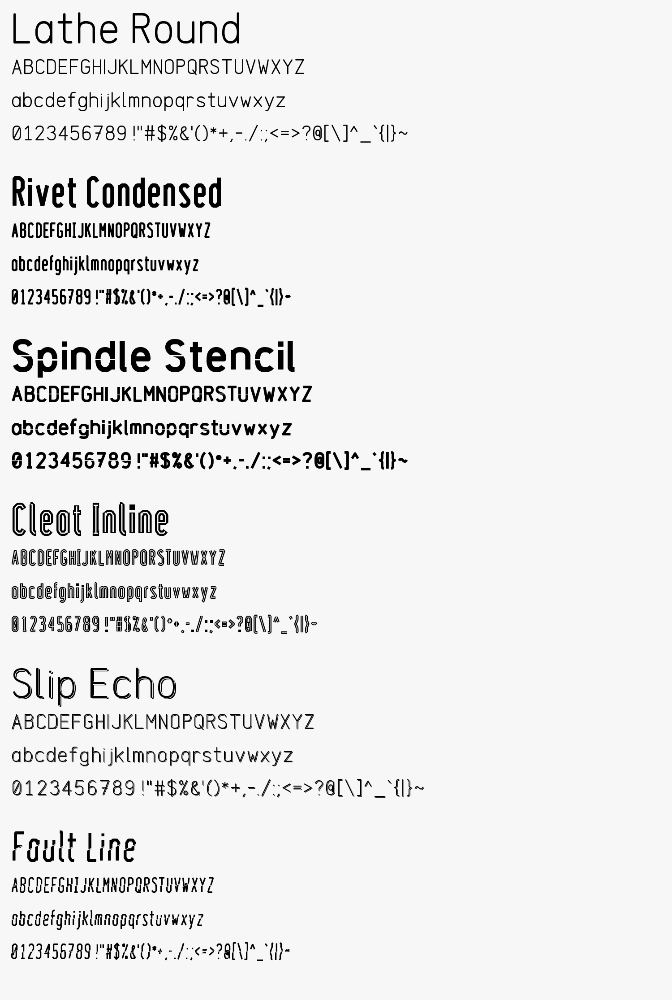
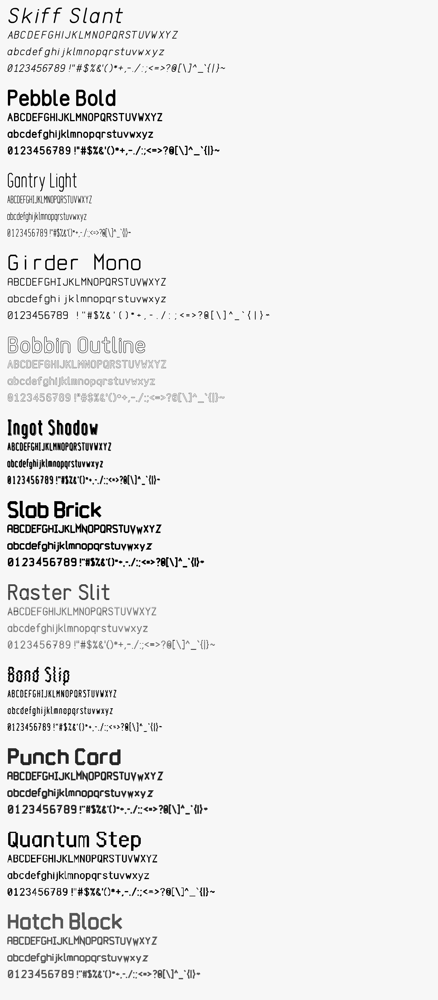
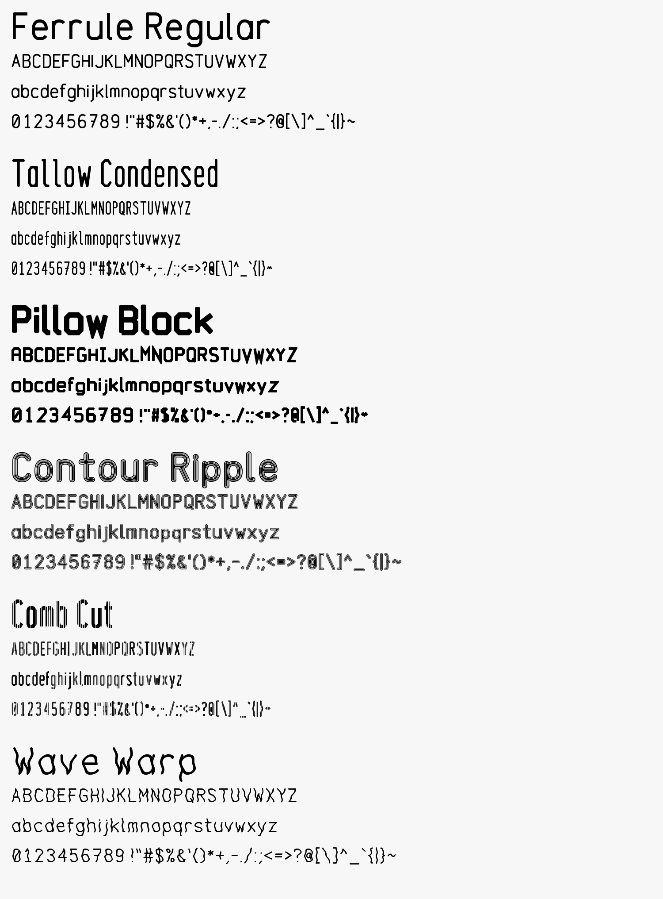
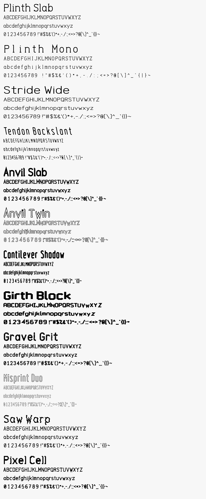
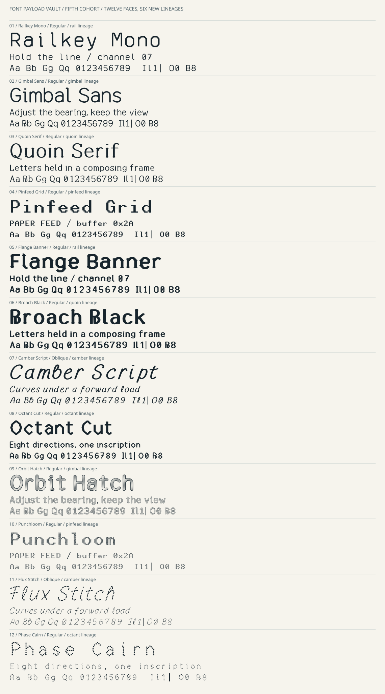
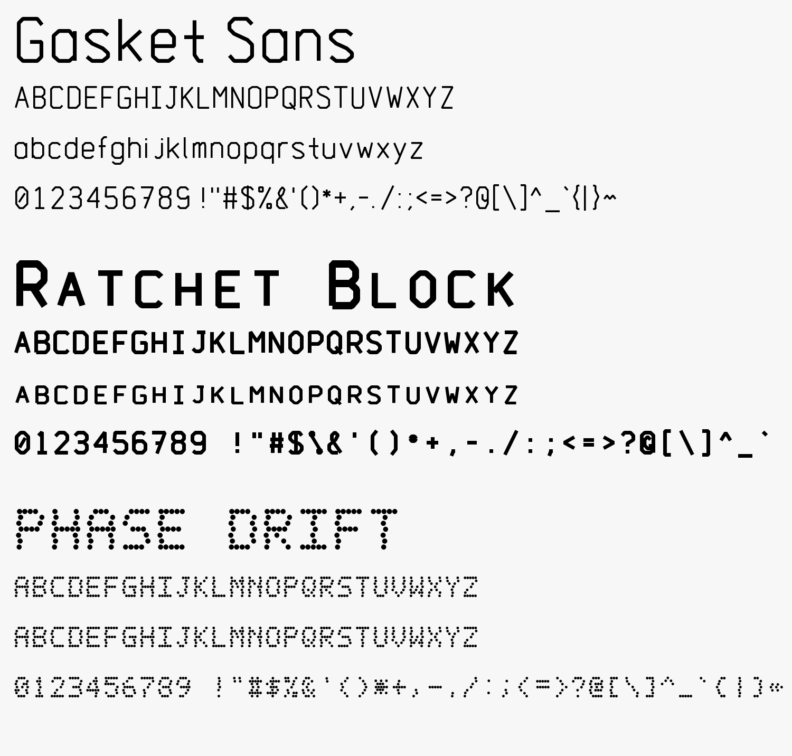
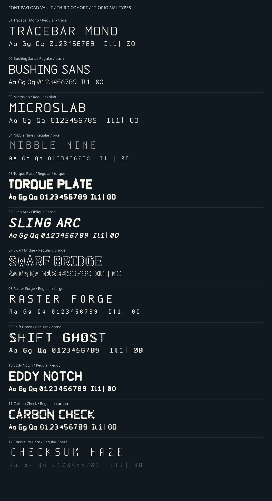
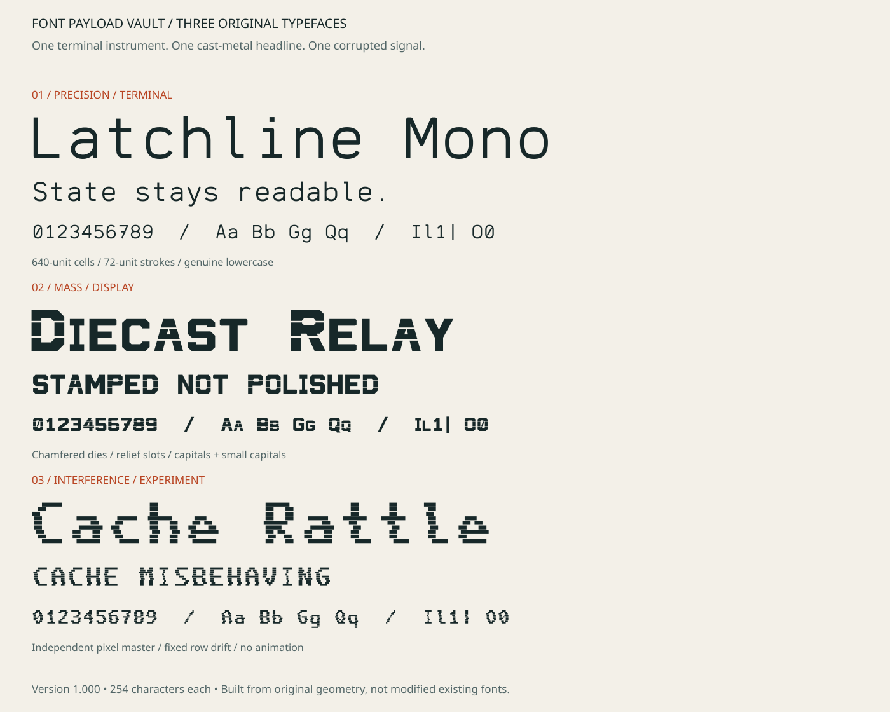

# Font Payload Vault

## Sixth Cohort / 06 — thirty-six new fonts

| Compartment | Families |
|---|---|
| [cmd-font-container](cmd-font-container/) | [Lathe Round](cmd-font-container/lathe-round/), [Rivet Condensed](cmd-font-container/rivet-condensed/), [Skiff Slant](cmd-font-container/skiff-slant/), [Pebble Bold](cmd-font-container/pebble-bold/), [Gantry Light](cmd-font-container/gantry-light/), [Girder Mono](cmd-font-container/girder-mono/), [Ferrule Regular](cmd-font-container/ferrule-regular/), [Tallow Condensed](cmd-font-container/tallow-condensed/), [Plinth Slab](cmd-font-container/plinth-slab/), [Plinth Mono](cmd-font-container/plinth-mono/), [Stride Wide](cmd-font-container/stride-wide/), [Tendon Backslant](cmd-font-container/tendon-backslant/) |
| [hot-font-box](hot-font-box/) | [Spindle Stencil](hot-font-box/spindle-stencil/), [Cleat Inline](hot-font-box/cleat-inline/), [Bobbin Outline](hot-font-box/bobbin-outline/), [Ingot Shadow](hot-font-box/ingot-shadow/), [Slab Brick](hot-font-box/slab-brick/), [Pillow Block](hot-font-box/pillow-block/), [Contour Ripple](hot-font-box/contour-ripple/), [Anvil Slab](hot-font-box/anvil-slab/), [Anvil Twin](hot-font-box/anvil-twin/), [Cantilever Shadow](hot-font-box/cantilever-shadow/), [Girth Block](hot-font-box/girth-block/) |
| [cachemonic](cachemonic/) | [Slip Echo](cachemonic/slip-echo/), [Fault Line](cachemonic/fault-line/), [Raster Slit](cachemonic/raster-slit/), [Band Slip](cachemonic/band-slip/), [Punch Card](cachemonic/punch-card/), [Quantum Step](cachemonic/quantum-step/), [Hatch Block](cachemonic/hatch-block/), [Comb Cut](cachemonic/comb-cut/), [Wave Warp](cachemonic/wave-warp/), [Gravel Grit](cachemonic/gravel-grit/), [Misprint Duo](cachemonic/misprint-duo/), [Saw Warp](cachemonic/saw-warp/), [Pixel Cell](cachemonic/pixel-cell/) |

Four new skeleton alphabets (round, condensed, rectilinear block, slab) in many construction
treatments; siblings on the same skeleton share letter structure. TTF + WOFF2, 254
characters, source, specimen, character map and offline tester per family, SIL OFL 1.1.
Build with `python tools/sixth_cohort/cohort.py`; render with
`python tools/sixth_cohort/render.py [--extra | --more | --last]`. Outline proofs only: no hinting,
Windows acceptance or readability study.
## Fifth Cohort / 05 — twelve new faces

| Practical / system | Workshop / display | Experimental |
|---|---|---|
| [Railkey Mono](cmd-font-container/railkey-mono/) | [Flange Banner](hot-font-box/flange-banner/) | [Orbit Hatch](cachemonic/orbit-hatch/) |
| [Gimbal Sans](cmd-font-container/gimbal-sans/) | [Broach Black](hot-font-box/broach-black/) | [Punchloom](cachemonic/punchloom/) |
| [Quoin Serif](cmd-font-container/quoin-serif/) | [Camber Script](hot-font-box/camber-script/) | [Flux Stitch](cachemonic/flux-stitch/) |
| [Pinfeed Grid](cmd-font-container/pinfeed-grid/) | [Octant Cut](hot-font-box/octant-cut/) | [Phase Cairn](cachemonic/phase-cairn/) |

Twelve faces from six newly authored alphabet lineages, with explicit sibling
relationships, original sources, TTF + WOFF2, 254 codepoints, design notes,
full maps and local testers. Includes new serif, looped cursive, weave, hatch
and fragmented-path directions. [Creation, qualification and limits](docs/FIFTH-COHORT-WORKFLOW.md).

## Fourth Cohort / 04 — three new fonts (1.100 remastered)

| Family | Intended use | Construction |
|---|---|---|
| [Gasket Sans](cmd-font-container/gasket-sans/) | Proportional UI labels and status text | Angular octagonal forms; bevelled polyline strokes |
| [Ratchet Block](hot-font-box/ratchet-block/) | Heavy headlines and poster labels | Thick uppercase skeletons; lowercase as small capitals |
| [Phase Drift](cachemonic/phase-drift/) | Experimental readouts and fictional signage | 5×7 dot rasters with fixed per-row phase drift |

Three new original faces, each with TTF + WOFF2, 254 encoded characters, editable
source, outline specimen, complete character map and an offline tester, under
SIL OFL 1.1. Remastered in 1.100 with ink-fitted spacing, square punctuation dots and larger small capitals (see the [workflow](docs/FOURTH-COHORT-WORKFLOW.md)). The render above is made by `python tools/fourth_cohort/render.py`. Built by `python tools/fourth_cohort/cohort.py`; the fonts' manifest
is [`docs/fourth-cohort-manifest.json`](docs/fourth-cohort-manifest.json). These
are outline proofs only: no hinting, Windows acceptance or readability study.
Read the [Fourth Cohort workflow](docs/FOURTH-COHORT-WORKFLOW.md).

## Third Cohort / 03 — twelve new fonts

| Practical / system | Workshop / display | Cachemonic / experimental |
|---|---|---|
| [Tracebar Mono](cmd-font-container/tracebar-mono/) | [Torque Plate](hot-font-box/torque-plate/) | [Shift Ghost](cachemonic/shift-ghost/) |
| [Bushing Sans](cmd-font-container/bushing-sans/) | [Sling Arc](hot-font-box/sling-arc/) | [Eddy Notch](cachemonic/eddy-notch/) |
| [Microslab](cmd-font-container/microslab/) | [Swarf Bridge](hot-font-box/swarf-bridge/) | [Carbon Check](cachemonic/carbon-check/) |
| [Nibble Nine](cmd-font-container/nibble-nine/) | [Raster Forge](hot-font-box/raster-forge/) | [Checksum Haze](cachemonic/checksum-haze/) |

Twelve new distinct faces across four **original alphabet lineages**, with
separate construction treatments, documented artistic goals and realistic
ergonomic limits. Each offers a TTF, WOFF2, 254 codepoints, editable sources,
complete character map, offline tester and SIL OFL 1.1. Read the
[creation and qualification workflow](docs/THIRD-COHORT-WORKFLOW.md).

Original type experiments with their complete design sources, rebuild tooling,
specimens and notes about what they are actually good for.

## Workshop Six / 02

| Family | Intended use | Construction |
|---|---|---|
| [Collet Sans](cmd-font-container/collet-sans/) | Proportional UI labels and short prose | Smooth oval counters, open forms, tabular digits |
| [Detent Slab](cmd-font-container/detent-slab/) | Fixed-pitch records and instrument text | Angular skeletons and selected slab terminals |
| [Flypress](hot-font-box/flypress/) | Condensed headings and workshop labels | Heavy stock and explicit counters; true lowercase |
| [Ribbon Torque](hot-font-box/ribbon-torque/) | Large decorative titles | Hollow ribbon silhouettes; genuine Oblique style |
| [Anode Bloom](cachemonic/anode-bloom/) | Dot-matrix titles and fictional electronics | Original six-column grid; separate emitter and halo |
| [Null Cartridge](cachemonic/null-cartridge/) | Reverse-field decorative labels | Original cutter alphabet inside notched carriers |

Six new alphabet/digit masters, each with TTF + WOFF2, 254 encoded characters,
true lowercase, an editable source, design rationale, OFL, full character map
and interactive offline tester. Five families have one Regular style; Ribbon
Torque has one Oblique style. Geometry and auxiliary-repertoire helpers are
reused transparently; existing family masters and payloads are unchanged.

Read the [Workshop Six production workflow](docs/WORKSHOP-SIX-WORKFLOW.md) for
creation techniques, provenance, reproducible builds, qualification and limits.
The individual DESIGN.md files distinguish artistic aims and utilitarian
intentions from measured results. Native Windows and human-factors acceptance
are not claimed. Experimental faces are not substitutes for important alerts.

## Original Trio / 01

| Family | Intended use | Character |
|---|---|---|
| [Latchline Mono](cmd-font-container/latchline-mono/) | Terminals, diagnostic panes, source listings | Monoline precision; genuine lowercase; fixed 640-unit cells |
| [Diecast Relay](hot-font-box/diecast-relay/) | Short titles and workshop-themed labels | Heavy chamfered solids; relief slots; proportional caps and small capitals |
| [Cache Rattle](cachemonic/cache-rattle/) | Short glitch titles and fictional diagnostics | Original pixel master; deterministic scanline tearing; fixed 660-unit cells |

Each is a new independent design with one Regular style, TTF + WOFF2, 254 encoded
characters, a full character map and an offline browser tester. They do not reuse
an existing font's outlines. The fonts, sources and accompanying design documents
are included in their respective folders under SIL OFL 1.1, with no Reserved
Font Names. This does not change the licensing status of older repository work.

Read the [production and verification workflow](docs/ORIGINAL-TRIO-WORKFLOW.md)
for provenance, build commands, checks and limits. Practical benefits and size
ranges are design intentions, not measured accessibility or reading-performance
claims. Download/clone the repository before opening an interactive specimen;
GitHub's source viewer does not execute the tester.

## Vault compartments

| Folder | Contents |
|---|---|
| [cmd-font-container](cmd-font-container/) | Terminal, command-line and system-UI faces, including the existing [Knurled Swarf](cmd-font-container/knurled-swarf/) multi-size pixel family |
| [hot-font-box](hot-font-box/) | Loud display, headline and poster work |
| [cachemonic](cachemonic/) | Deliberately broken grids and visual experiments |
| [abandonware](abandonware/) | Retired experiments, preserved with reasons for retirement |

The [name-idea archive](docs/subfolder-name-ideadump-refonly.md) is reference
material, not a specification or source of glyph outlines.
