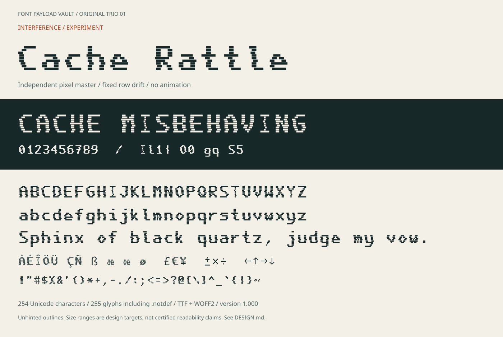

# Cache Rattle

An original broken-grid display experiment: a seven-column bitmap alphabet with
scanline gaps and reproducible, glyph-specific horizontal tears. It is corrupted
**by construction**, not by modifying a pre-existing typeface.



| Item | Value |
|---|---|
| Installable family | **Cache Rattle** |
| Style | Regular, version 1.000 |
| Desktop | [`fonts/CacheRattle-Regular.ttf`](fonts/CacheRattle-Regular.ttf) |
| Web | [`fonts/CacheRattle-Regular.woff2`](fonts/CacheRattle-Regular.woff2) |
| Advance | Exactly 660 units; fixed pitch, but not intended for daily terminal use |
| Coverage | 254 Unicode characters; 255 glyphs including `.notdef` |
| Initial trial sizes | 32–96 px; 48 px or above exposes the scanline construction clearly |
| Licence | [SIL OFL 1.1](OFL.txt), no Reserved Font Names |

Use for short glitch titles, fictional diagnostic screens, cover art and
nonessential interface decoration. Do **not** use its distortion for passwords,
operational alarms, dense source code or long-form reading. No accessibility,
fatigue-reduction or reading-performance claim is made.

Open [`specimen/index.html`](specimen/index.html) locally to test your own text,
size and polarity. GitHub's file viewer does not execute it. It reports missing
font loads and unsupported characters; the
[static character map](specimen/character-map.svg) records all mappings.
Install the TTF using the system font installer and select **Cache Rattle**.
Windows installation itself still needs a user-machine check.

The visible pixels are scalable outline rectangles, not embedded bitmap strikes.
There is no animation, runtime randomness or OpenType alternation: a character
has the same tear every time. Letter case is genuine; lowercase has its own
bitmap drawings. Auxiliary symbols and accents deliberately remain comparatively
clean, and box-drawing/block geometry is not torn.

Coverage includes ASCII, printable Latin-1/Windows-1252 and selected technical
symbols, not all Unicode. Use precomposed Latin accents; combining sequences are
unsupported. It has one weight, no italic, no hinting and no ligatures.

[DESIGN.md](DESIGN.md) documents the original grids, deterministic tear rule,
aesthetic intent and limitations. See the shared
[build workflow](../../docs/ORIGINAL-TRIO-WORKFLOW.md), or run from the repo root:

```sh
python -m pip install -r requirements-original-trio.txt
python tools/original_trio/build.py
python tools/original_trio/verify.py
python tools/original_trio/specimen.py
```

This folder and its original source, outputs and documentation are Font Software
under the included OFL.
