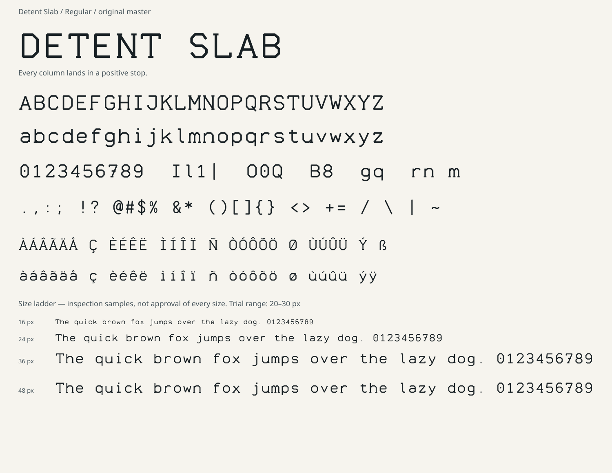

# Detent Slab

**Every column lands in a positive stop.**



| Property | First release |
|---|---|
| Style | Regular |
| Version | 1.000 |
| Formats | TrueType / WOFF2 |
| Coverage | 254 codepoints, 255 glyphs including `.notdef` |
| Spacing | Fixed 720-unit advance for every mapped character |
| Initial trial range | 20–30 px; design intent, not measured acceptance |
| License | [SIL OFL 1.1](OFL.txt), no Reserved Font Names |

## Use and inspect

The installable desktop file is `fonts/DetentSlab-Regular.ttf`. On Windows, the usual
font-file **Install** / **Install for all users** menu can be used; native Windows
installation and rendering have not been acceptance-tested for this release.
The web file is `fonts/DetentSlab-Regular.woff2`.

Open [the interactive tester](specimen/index.html) from a local checkout or an
extracted repository archive. GitHub displays its source, not the interactive
page. The tester has a text field, size / line-height / tracking controls,
polarity toggle, full repertoire and explicit missing-character / load-failure
warnings. It makes no external font or script requests. A browser font-load
failure is reported rather than quietly labeling fallback as this typeface.

[DESIGN.md](DESIGN.md) explains construction, stylistic aims, practical intentions,
trade-offs and explicit exclusions. The [full character map](specimen/character-map.svg)
shows every mapped glyph, including the supporting repertoire's mixed construction.

```css
@font-face {
  font-family: "Detent Slab";
  src: url("fonts/DetentSlab-Regular.woff2") format("woff2");
  font-style: normal;
  font-weight: 400;
}
.sample {
  font-family: "Detent Slab", monospace;
  font-style: normal;
  font-synthesis: none;
  line-height: 1.25;
}
```

## Rebuild and qualify

From the **repository root**, not this family folder:

```sh
python -m pip install -r requirements-workshop-six.txt
python tools/workshop_six/build.py
python tools/workshop_six/verify.py --require-ots
python tools/workshop_six/specimen.py
python -m playwright install chromium
python tools/workshop_six/browser_smoke.py
```

`ots-sanitize` and FreeType are required system dependencies; the shared
[workflow](../../docs/WORKSHOP-SIX-WORKFLOW.md) gives the complete commands,
non-destructive CI procedure and qualification records. These commands rebuild
all six new families, leaving the older families untouched. There are no
ligatures or pair kerning in this cohort's first release.

Copyright (c) 2026 techrote. Original AI-assisted procedural design.
