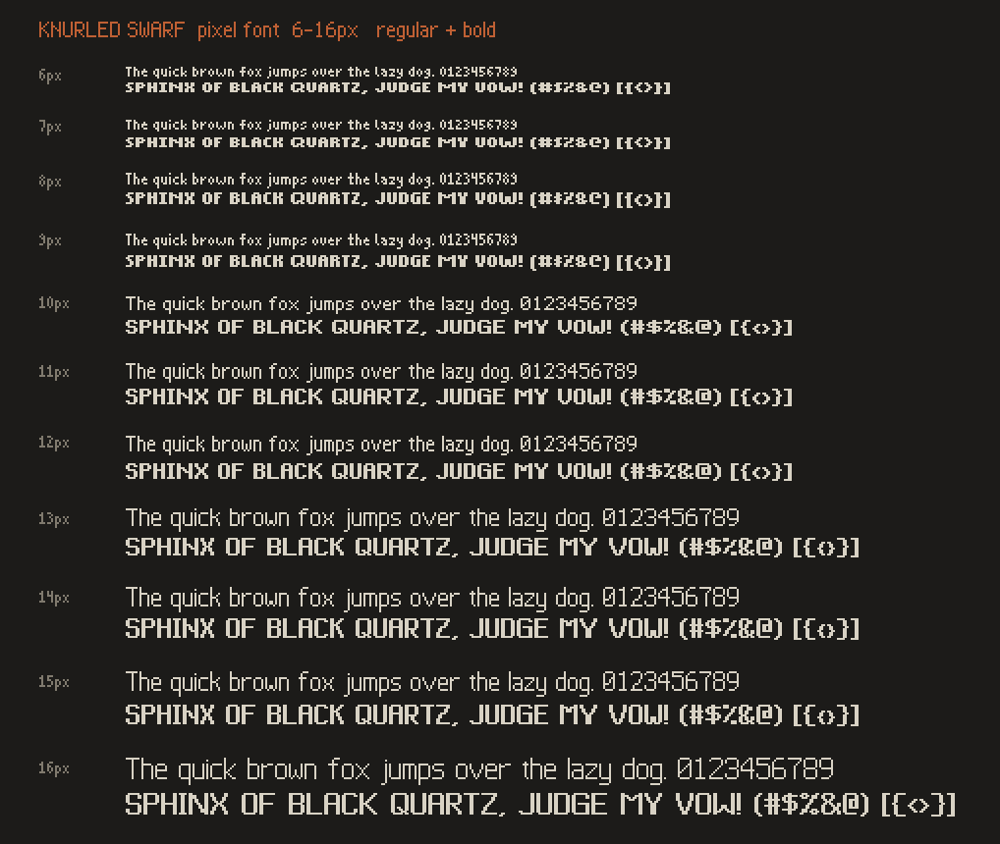
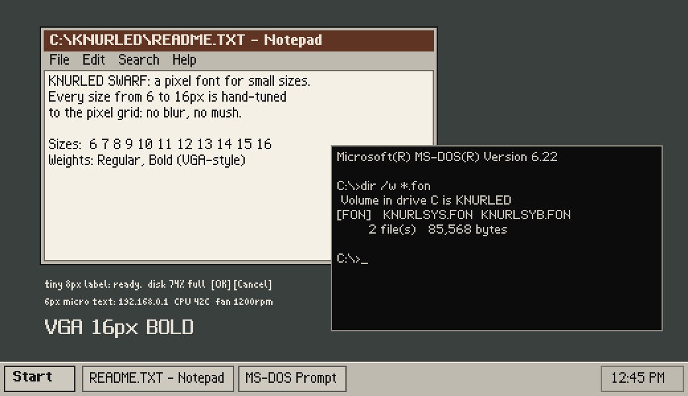

# Knurled Swarf

A DOS / Windows-3.x-flavoured "system" pixel font. Each pixel size from **6px to 16px** is drawn on its own grid,
so text is sharp at every size, with no scaled-down blur. Proportional spacing, Regular + Bold (VGA-style smear).

*Swarf* is the curl of metal that comes off a lathe or mill. *Knurling* is the grid of tiny raised diamonds rolled into a
tool handle for grip: a pixel grid in steel, which is exactly what this font is.



## Which file do I install?

| You want… | Install | Shows up as |
|---|---|---|
| **One font that's sharp at 6–16px in normal Windows apps** | `fonts/KnurledSwarf-Regular.ttf`, `fonts/KnurledSwarf-Bold.ttf` | **Knurled Swarf** |
| **Guaranteed-sharp anywhere (WPF/RetroBar, browsers, Electron)** | `fonts/per-size/KnurledSwarf{N}px-*.ttf` | **Knurled Swarf 6px … Knurled Swarf 16px** |
| Real Windows raster font (classic GDI apps) | `fonts/windows-fon/KnurledSwarfSys.fon`, `KnurledSwarfSys-Bold.fon` | **Knurled Swarf Sys** |
| Web pages | `fonts/web/*.woff2` | (CSS `@font-face`) |
| Linux / bitmap tools | `fonts/bdf/*.bdf` | |

Install on Windows: right-click the `.ttf` / `.fon` → **Install for all users**. The family names don't clash, so you can install all of them.

- The universal TTF holds all 11 sizes as embedded bitmaps plus an outline fallback (crisp at 10, 20, 30, 40px).
  At 125%/150% display scaling it simply picks the matching hand-tuned size.
- Per-size fonts are pixel-exact at exactly N px (and at 2×, 3×…). Use these where the app ignores embedded bitmaps.
- The `.fon` files cover Latin-1/cp1252 only (no box drawing).

Try it before installing: open [`specimen/specimen.html`](specimen/specimen.html) locally (type your own text at any size/weight/zoom).

## Sizes

Font size includes line spacing, so some neighbouring sizes share a letter height and differ only in spacing:

| px | 6 | 7 | 8 | 9 | 10 | 11 | 12 | 13 | 14 | 15 | 16 |
|---|---|---|---|---|---|---|---|---|---|---|---|
| cap height | 5 | 5 | 6 | 6 | 7 | 8 | 8 | 9 | 10 | 10 | 11 |
| x-height | 4 | 4 | 4 | 4 | 5 | 6 | 6 | 7 | 7 | 7 | 8 |

At 100% Windows scaling: 8pt = 11px (the classic UI size), 9pt = 12px, 10pt = 13px, 12pt = 16px.

## Notes

- **WPF (RetroBar):** use a per-size font and set `UseLayoutRounding="True"`, `TextOptions.TextFormattingMode="Display"`
  (optionally `TextOptions.TextRenderingMode="Aliased"`).
- Coverage (274 glyphs): ASCII, Latin-1 accented letters, cp1252 punctuation (€ “ ” – — … •), arrows, ▲►▼◄, ✓ ✗, card suits,
  single/double box drawing, block and shade characters, ■□●○.
- Every glyph in every file is round-trip checked with FreeType against the source bitmaps (pixel-exact, zero grey pixels in
  anti-aliased renders), and all TTF/WOFF2 files pass the OpenType Sanitizer.
- Not yet tested inside Windows itself: confirm GDI picks the embedded sizes and that the `.fon` installs.



## Rebuilding / editing

Everything is generated from the text grids in `source/`. See [WORKFLOW.md](WORKFLOW.md) for the full pipeline.

```
pip install -r requirements.txt
cd source
python build.py && python verify.py && python specimen.py && python make_tester.py
```

Copyright (c) 2026 techrote. Version 1.000.

## Ratings

Scored with [docs/rating-system.md](../../docs/rating-system.md). The request targets were inferred from the original brief
("system/MS-DOS style pixel font that works at 6–16px").

| dial   | requested | achieved | note |
|--------|-----------|----------|------|
| cool   | 7 | 7 | Bold at 11px and 16px is the showpiece; Regular at 16px is a little thin |
| cringe | 0 | 1 | bold at 6–9px is chunky |
| work   | 9 | 9 | proportional system-font workhorse |
| cyber  | 8 | 7 | DOS/Win3.x DNA, box drawing and blocks; proportional rather than terminal-mono |
| wrap   | 5 | 6 | rounded-top A and slashed zero give it a recognisable face |
| watch  | 0 | 0 | |

**Name:** Knurled Swarf: `cool 8 · cringe 1 · uninsp 2 · cyber 4 · wrap 8 · watch 2` (total 25)
Filters: folder ✓ · texture ✓ · collision ✓ · length ✓ ("Knurled Swarf 16px Bold" = 23 chars)
Runner-up names: Chattered Swarf, Snarled Swarf. Former name: Blued Swarf (dropped: colour name).
