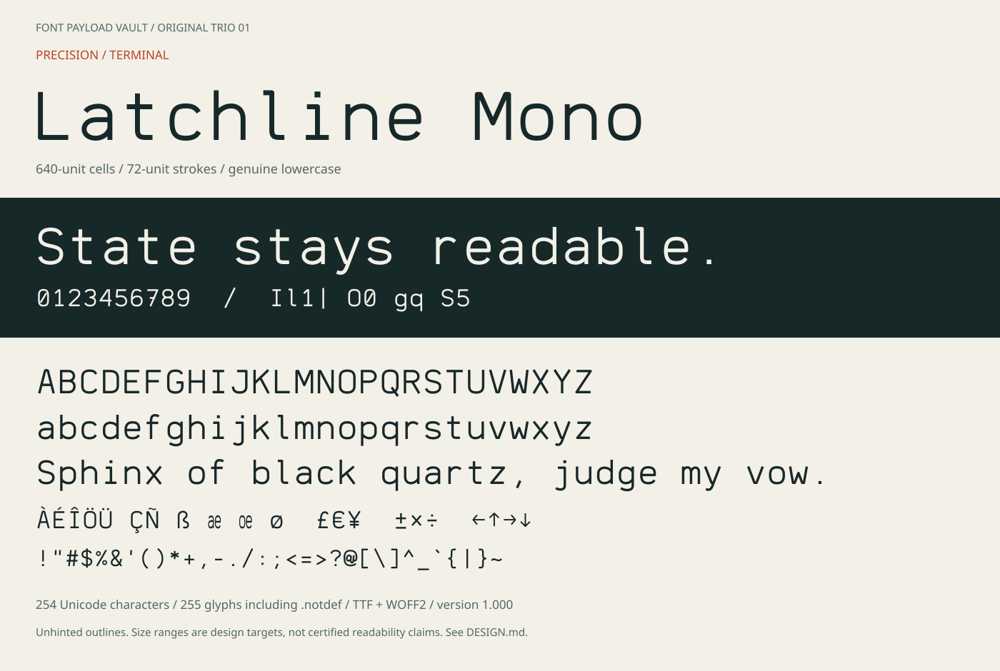

# Latchline Mono

An original monospaced instrument face: squared shoulders, open lowercase,
a slashed zero and deliberately different `I l 1 |`. Designed for terminal
panes, machine-state readouts, source listings and compact diagnostic interfaces.



| Item | Value |
|---|---|
| Installable family | **Latchline Mono** |
| Style | Regular, version 1.000 |
| Desktop | [`fonts/LatchlineMono-Regular.ttf`](fonts/LatchlineMono-Regular.ttf) |
| Web | [`fonts/LatchlineMono-Regular.woff2`](fonts/LatchlineMono-Regular.woff2) |
| Advance | Exactly 640 units for every glyph; 1000 units/em |
| Coverage | 254 Unicode characters; 255 glyphs including `.notdef` |
| Initial trial sizes | 16–24 px; assess the actual application and display |
| Licence | [SIL OFL 1.1](OFL.txt), no Reserved Font Names |

These are **unhinted scalable outlines**, not a replacement for Knurled Swarf's
hand-tuned 6–16 px bitmap masters. There is one weight, no italic and no
programming ligatures. Fixed advance and recognizable shapes are design
intentions; no reading-speed, fatigue or accessibility benefit has been measured.

Open [`specimen/index.html`](specimen/index.html) after downloading/cloning the
repository to try your own text without installing. It reports failed font loads
and unsupported characters instead of silently presenting a fallback as this font.
GitHub's file viewer does not execute the interactive tester. The
[complete character map](specimen/character-map.svg) works as a static reference.

For desktop use, install the TTF through your operating system's font installer,
then select **Latchline Mono**. Windows installation and DirectWrite/GDI behavior
still require a local check; the automated qualification uses FreeType and OTS.
Start with normal line spacing: the font's declared line box is 1.25 em.
Box-drawing cells join at those metrics; added line spacing or terminal-specific
cell overrides can introduce seams.

ASCII, printable Latin-1 and the printable Windows-1252 repertoire are included,
plus selected arrows, math, box drawing and blocks. Accented letters are
precomposed; decomposed combining sequences, non-Latin scripts and arbitrary
Unicode terminal art are not supported. Normalize suitable Latin text to NFC
outside the font; do not mistake this for broad multilingual support.

Read [DESIGN.md](DESIGN.md) for construction, artistic decisions, ergonomic
intentions and limitations. Rebuild from the repository root:

```sh
python -m pip install -r requirements-original-trio.txt
python tools/original_trio/build.py
python tools/original_trio/verify.py
python tools/original_trio/specimen.py
```

The shared [workflow](../../docs/ORIGINAL-TRIO-WORKFLOW.md) explains dependencies,
reproducibility and required CI checks. This folder and its original source,
outputs and documentation are Font Software under the included OFL.
