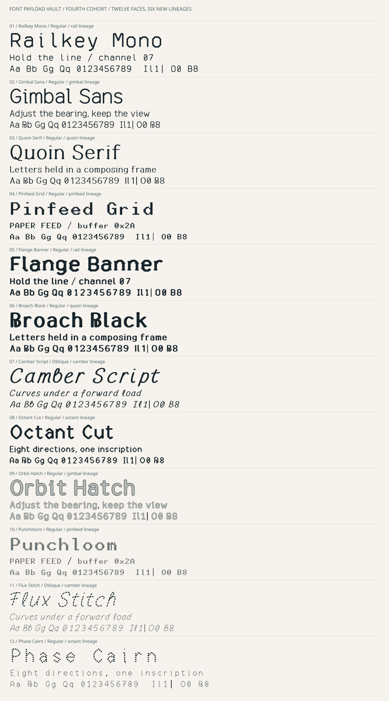

# Fourth Cohort / 04 — twelve faces from six new lineages

Inspected base: `5ef683bbc74e7a0d52f41a898b7a44b232b21e40` on `main`.
The previous dozen was already merged; no competing open PR was present.
The category briefs, previous sources/docs and prior specimens informed the
new work. Existing families, masters, archived names and retirement files are
not modified. Only root/category indexes receive additive links.



## Design register

| Family | New lineage | Style | Construction / intention |
|---|---|---|---|
| [Railkey Mono](../cmd-font-container/railkey-mono/) | rail | Regular | Folded shoulders; fixed cells; plain operational rhythm. |
| [Gimbal Sans](../cmd-font-container/gimbal-sans/) | gimbal | Regular | Open curves and asymmetry for proportional instrument labels. |
| [Quoin Serif](../cmd-font-container/quoin-serif/) | quoin | Regular | Wedge serifs and deliberate stroke contrast for short explanatory text. |
| [Pinfeed Grid](../cmd-font-container/pinfeed-grid/) | pinfeed | Regular | Continuous 8-column cells; controller and paper-feed rhythm. |
| [Flange Banner](../hot-font-box/flange-banner/) | rail | Regular | Heavy folded stock with tabs on long vertical strokes. |
| [Broach Black](../hot-font-box/broach-black/) | quoin | Regular | Dense wedge-serif lettering; large foundry-style titles. |
| [Camber Script](../hot-font-box/camber-script/) | camber | Oblique | Looped independent cursive letters with a forward load. |
| [Octant Cut](../hot-font-box/octant-cut/) | octant | Regular | Narrow faceted monumental lettering with true lowercase. |
| [Orbit Hatch](../cachemonic/orbit-hatch/) | gimbal | Regular | Continuous letter edges enclosing diagonal engraving. |
| [Punchloom](../cachemonic/punchloom/) | pinfeed | Regular | Alternating cut modules make the letter grid look woven. |
| [Flux Stitch](../cachemonic/flux-stitch/) | camber | Oblique | Arclength dashes follow looped curves, not scan rows. |
| [Phase Cairn](../cachemonic/phase-cairn/) | octant | Regular | Separated tangent-aligned stones; readable fragmentation. |

## What is independently new

There are **six newly authored 62-character letter/figure masters**, not twelve
independent alphabets: `rail`, `gimbal`, `quoin`, `pinfeed`, `camber`, `octant`.
They are stored as inspectable source in `tools/fourth_cohort/masters/`. Each
supports two openly related family recipes in the individual `source/design.py`
files. The rail/facet paths, open curves, contrast-serif skeleton, looped cursive
and eight-column grid were entered for this cohort, without extracting, tracing,
renaming or filtering any earlier font's letters.

The cohort contributes its own shared ASCII punctuation and treatment engine.
Original Trio's `geometry.py` and `repertoire.py` are reused unchanged for geometry
normalization and neutral auxiliary recipes. Their exact Git blob identities are
regression-checked. This reuse includes some accent/currency/functional shapes;
those are not falsely presented as twelve independently drawn international
repertoires. Master/recipe/compiler/helper SHA-256 values accompany the output
manifest, making the actual dependency boundary inspectable.

The new contribution follows the vault's utilitarian/display/experimental split
but adds serif contrast, genuinely looped cursive, over/under modules, hatching
and arclength fragmentation rather than twelve more scanline variations.

## Geometry and export contract

The UPM is 1000, ascent/descent 1000/-250, and line gap zero. Five continuous
lineage masters use original M/L/C/Z paths; cubics are sampled at 24 intervals.
Nib geometry uses affine circle buffers. The grid master has eight columns,
eleven capital rows and meaningful leading/descender rows in lowercase.
Every final contour is normalized and integer-quantized. TTF and WOFF2 contain
the same unhinted, quadratic-free outlines and deterministic metadata.

All twelve have real lowercase, 254 mapped codepoints and 255 glyph records.
Their cmap is identical in coverage, not in artwork. Railkey Mono, Pinfeed Grid,
Punchloom and Phase Cairn have one advance for every encoded glyph. The other
eight are proportional with tabular figures. Camber Script and Flux Stitch are
real Oblique styles; names, flags, caret slope and negative italic angle agree.
Cap/x-height metadata is tied to H/x ink bounds, not guessed from nominal paths.

ASCII punctuation remains neutral; styled alphabet bodies feed precomposed
accent assembly. Only nonfunctional glyphs that exceed -242..984 are fitted
vertically, never cropped. Those exact fits are listed in the manifest. Box and
block geometry spans the full 1250-unit cell. No kerning, ligatures, variation
axes or bitmap strikes are supplied. Each face-specific DESIGN.md records its
actual nib, treatment, shared lineage, aesthetic intention and use limits.

## Rebuild and inspect

From the repository root, use Python 3.12 and the inherited pinned toolchain:

```sh
python -m pip install -r requirements-fourth-cohort.txt
python tools/fourth_cohort/build.py
python tools/fourth_cohort/docs.py
python tools/fourth_cohort/specimen.py
python tools/fourth_cohort/verify.py
python tools/fourth_cohort/docs.py --check
python tools/fourth_cohort/specimen.py --check
```

For mandatory hosted font/browser acceptance:

```sh
sudo apt-get update
sudo apt-get install -y --no-install-recommends libfreetype6 opentype-sanitizer
python -m playwright install --with-deps chromium
python tools/fourth_cohort/verify.py --require-ots --report docs/fourth-cohort-verification.json
python tools/fourth_cohort/browser_smoke.py --report docs/fourth-cohort-browser-verification.json
python tools/fourth_cohort/verify.py --require-ots --require-records
```

`--output /tmp/fourth-cohort-rebuild` builds to an isolated root. Normal CI does
not rebuild over committed fonts before checking them. `docs.py --check` and
`specimen.py --check` reject stale generated documentation and proofs.
`browser_smoke.py --executable /path/to/chromium` is an optional local override;
hosted acceptance uses Chromium installed by the pinned Playwright package.
A missing local sanitizer can be reported as a skip without `--require-ots`;
that is not hosted acceptance. Environment-blocked browser runs are not passes.

After an intentional source edit, remove the old two success reports before
requalifying, then retain newly produced font and browser records together.
The binding tests deliberately reject successful records for different font or
source bytes. Do not weaken that check to make an old pass survive a new design.

## What qualification establishes

There are **20 test groups**, covering all six master inventories; complete
coverage/nonempty valid area; bounds, pitch and tabular figures; exact serialized
contours/bearings; names/styles/ink heights; output and source manifest binding;
**9,144 paired FreeType renders** at 18/36/68 px; four practical faces' confusable
signatures at 18/24/32 px; enclosed counters at 24/32/40 px; functional tiling;
distinct final alphabets and true lowercase; malformed-source rejection; real
stitch gaps; grid/weave and i-dot geometry; serif/flange/hatch/cairn regressions;
nonclipping vertical fits; unchanged shared helpers; two independent hash-seed
rebuilds; mandatory OTS for all 24 exports; and retained evidence binding.

Selected raster differences/counters are limited engineering assertions, not
proof of reading performance. The parser and geometry regressions protect real
review findings rather than relying on font filenames being different.

The **37 specimen outputs** are a path-based SVG proof, complete character map
and local HTML tester for every face, plus a cohort overview. Lettering is
extracted from the compiled TTF. Proof size-ladder labels use unscaled short
samples so an automatic fit cannot mislabel a reduced sample as a larger size.
Only explanatory SVG labels use a generic UI font.

All twelve testers are checked over loopback HTTP and direct file URLs: actual
family selection, font loading, 254 repertoire cells, literal user text rather
than HTML, missing combining/astral-codepoint warnings, size/leading/tracking,
polarity, full reset and visible failure in a fresh context when the WOFF2 is
blocked. No CDN or external requests are needed. Chromium acceptance is not
universal-browser or Windows-installation acceptance.

## Review findings and publication

Source/visual review widened the Octant i/j dot segments, gave Quoin l an exit,
raised the grid i-dot above the accent-removal boundary, widened stitch gaps
that rounded caps originally closed, tied height metadata to actual ink, and
kept proof ladder text at its labelled size. The corresponding deterministic
regressions are part of the delivered tests.

Only checksummed UTF-8 source text is staged for initial publication on the
dedicated branch. A hosted runner builds the fonts and verifies that its complete
manifest matches the locally reviewed identity, runs mandatory font/browser
qualification, generates docs/proofs and commits the outputs. Temporary source
transport is removed. The write-enabled bootstrap workflow is then replaced
with read-only regression CI before the final PR is reviewed.

Squash merge keeps transport out of main history. Merge only after current-head
CI succeeds; verify the landed main tree and its normal post-merge run without
starting duplicate workflows. The PR discussion records those actual identities.
Retained JSON is historical, source/font-hash-bound evidence, not proof of an
arbitrary later branch head. Source files and existing families remain available
for inspection even when a font is not suitable for a particular user.

## Explicit limits and licence scope

No native Windows installation, GDI/DirectWrite/ClearType comparison, monitor or
print trial, human-factors study, regulated signage test, physical stencil,
engraving, weaving or embroidery qualification is claimed. Decorative geometry
is not a toolpath. Experimental text must not be the sole channel for important
alarms, credentials or transcription. Trial sizes are design contexts, not
certifications or measured accessibility advantages.

New font software, source, proofs and design documents use the accompanying SIL
OFL 1.1 with no Reserved Font Names. Existing families/archive material is not
relicensed. The original helper licences remain in place.

## Technical references

- FontTools official documentation: https://fonttools.readthedocs.io/
- OpenType OS/2 metrics and style flags: https://learn.microsoft.com/en-us/typography/opentype/spec/os2
- Prior production context: [Third Cohort](THIRD-COHORT-WORKFLOW.md) and [Original Trio](ORIGINAL-TRIO-WORKFLOW.md).

These explain formats and tools. Actual new artwork is the source; software
acceptance is the exact manifest and CI evidence, not a tooling citation.
