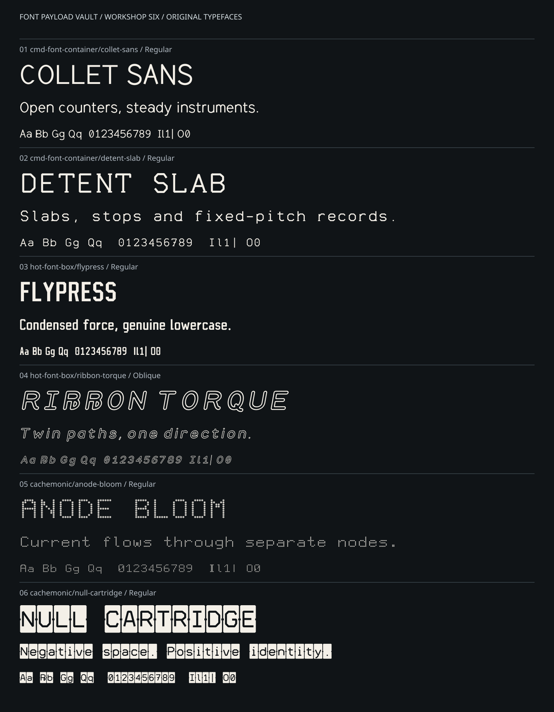

# Workshop Six — provenance, production and qualification

This is the second new-design cohort, added after the Original Trio. The inspected
base was `e01ca2671dc677a430ef12bd512a8153ced0bf00` on `main`. No open PR competed
with this work at inspection. Knurled Swarf, the Original Trio's masters/exports,
the retirement compartment and the naming archive are not rewritten.



## The six briefs

| Family | Category | Independent construction | Main intention |
|---|---|---|---|
| [Collet Sans](../cmd-font-container/collet-sans/) | System UI | Oval solids/counters, rectangular stems, authored curves | Quiet proportional labels and prose; tabular digits |
| [Detent Slab](../cmd-font-container/detent-slab/) | System UI | Angular skeletons with individually assigned slabs | Fixed-pitch records and instrument text |
| [Flypress](../hot-font-box/flypress/) | Display | Condensed positive/negative stock and heavy diagonals | Strong short headings with true lowercase |
| [Ribbon Torque](../hot-font-box/ribbon-torque/) | Display | New flowing skeletons, resolved hollow border, 0.18 shear | Large inline-ribbon titles; explicit Oblique style |
| [Anode Bloom](../cachemonic/anode-bloom/) | Experiment | New six-column grid; emitter and separated annular halo | Monochrome dot-matrix display texture |
| [Null Cartridge](../cachemonic/null-cartridge/) | Experiment | New cutter alphabet subtracted from a notched carrier | Reverse-field decorative labels |

All six have real lowercase drawings, not lowercase-to-capital cmap aliases.
Each provides one style and two formats: TTF and WOFF2. Five styles are named
Regular; Ribbon Torque's sole style is Oblique. These are separate designs,
not six weights or filters of one shared Latin alphabet. Naming and category
attitudes are inspired by the vault; no existing font's outlines or pixel grids
are imported, traced, renamed or used as masters.

## What is new, and what is reused

Each family's `source/design.py` contains its own alphabet and numeral source.
Anode Bloom also supplies a complete ASCII grid. The other five use the new
cohort's explicit shared punctuation in `tools/workshop_six/common.py`, with
family-dependent fitting and, where appropriate, decoration. Simple geometric
constructors are shared; that is not a shared alphabet master.

The existing `tools/original_trio/geometry.py` and `repertoire.py` are reused
**unchanged**. They provide Boolean geometry, curve sampling, deterministic
integer contour ordering and extension of the current family's own ASCII
bodies to the declared auxiliary repertoire. This deliberate reuse includes
some existing neutral accent and symbol recipes. The new artwork is therefore
not claimed to be an independent redraw of every punctuation/currency symbol
in every family. The six individual DESIGN.md files identify the stylistic
consequences, especially the clean supporting symbols in experimental faces.

New build and test code is under `tools/workshop_six/`. The sources, exports and
accompanying design documents carry SIL OFL 1.1 with no Reserved Font Names.
The existing OFL text is copied into each new family and the new tool directory.
This scope does not grant or change rights in older repository material.

## Build pipeline

```text
six independent source/design.py masters
  -> own Latin alphabets/digits + explicit ASCII punctuation
  -> unchanged repertoire.extend(current family's own components)
  -> optional finalizer (Null Cartridge inversion AFTER accent composition)
  -> integer, normalized polygon contours
  -> FontBuilder / glyf / hmtx / cmap / OS/2 / post / names
  -> TTF and WOFF2, deterministic timestamps, SHA-256 manifest
  -> exported-font SVG outlines, complete character maps, local HTML testers
  -> source/outline/metrics/raster/rebuild/OTS/browser qualification
```

All fonts use a 1000-unit em and 1000/-250 line metrics, with zero added line gap.
Functional boxes are generated for that 1250-unit cell. Curve primitives are
sampled into straight segments; there are no native quadratic curves, TrueType
instructions, embedded bitmap strikes, variation axes, ligatures or kerning
features in this cohort. Polygonal approximation may become visible at extreme
magnification. Windows-specific behavior is not inferred from the file format.

Fixed pitch is advertised only for Detent Slab, Anode Bloom and Null Cartridge.
All six have tabular digits; their actual advances are 600, 720, 500, 760, 720
and 760 units respectively. Ribbon Torque's italic/oblique selection bits,
`head.macStyle`, negative italic angle and caret slope agree. Null Cartridge's
cap/x-height metadata describes its full ink carrier (992 units), not the
smaller negative letter cutout inside it.

## Rebuild commands

From the repository root, use Python 3.12 and the existing pinned toolchain:

```sh
# Debian/Ubuntu system packages used by hosted qualification:
sudo apt-get update
sudo apt-get install -y --no-install-recommends libfreetype6 opentype-sanitizer
python -m pip install -r requirements-workshop-six.txt
python -m playwright install --with-deps chromium

# Developer edit/rebuild loop:
python tools/workshop_six/build.py
python tools/workshop_six/verify.py --require-ots
python tools/workshop_six/specimen.py
python tools/workshop_six/specimen.py --check
python tools/workshop_six/browser_smoke.py
```

`requirements-workshop-six.txt` includes the existing pinned build and browser
requirements rather than introducing a conflicting dependency set. A missing
OpenType Sanitizer is a **failure** when `--require-ots` is present. An explicit
local run without that flag may report an OTS skip; it is not hosted acceptance.

To test a rebuild without replacing checked-in exports:

```sh
python tools/workshop_six/build.py --output /tmp/workshop-six-rebuild
```

The output root receives only the six new font payloads and their manifest.
Source paths still resolve from this repository. After an intentional design
change, regenerate the fonts and specimens together. Refresh retained reports
only from the corresponding successful font/browser runs. The report-binding
test rejects an old successful report whose manifest no longer matches the
newly generated bytes; remove that old record deliberately before requalifying
rather than weakening the binding check.

## What the checks actually establish

`verify.py` has 14 groups: complete ASCII and declared coverage; nonempty glyphs;
valid geometry; cell/bounds containment; pitch and tabular digits; exact
source-to-compiled contour and metric correspondence; metadata and style flags;
manifest sizes/hashes; paired raster output; practical confusable differences;
practical enclosed counters; independent-process reproducibility; mandatory OTS;
family-specific construction; cell tiling; different family alphabets; and
retained-report binding (several related checks share a group).

The full raster comparison is **6 × 254 × 3 = 4,572** paired TTF/decoded-WOFF2
renders, at 16/32/64 px. Selected Collet/Detent confusables are compared at
18/22/28 px, excluding advance width as a distinguishing signal. Selected
counters are checked at 22/28/36 px. Independent subprocesses with Python hash
seeds 17 and 991 must reproduce all 12 files and the manifest byte for byte.

The specimen generator emits **19 deterministic outputs**: a specimen SVG,
complete map and local HTML tester for each family, plus the cohort overview.
SVG lettering is extracted from the compiled TTF, not reproduced using a
fallback font. Only explanatory labels use a generic UI font. `--check` compares
outputs without writing over them, so stale proofs fail.

The browser harness checks all six testers over loopback HTTP and through
`file://` URLs. It verifies font loading, 254 repertoire cells, controls,
polarity, reset, missing Unicode warnings, literal input rather than HTML,
visible font-load failures, and absence of external requests / script errors.
It is Chromium acceptance, not an assertion about every browser.

## Publication and retained evidence

The initial publication transfers only checksummed UTF-8 source/documentation
text to a dedicated branch. A hosted runner expands the allowlisted source set,
compiles the fonts, compares the font manifest with the locally reviewed design
identity, runs mandatory qualification, and commits the generated payloads.
No installed or downloaded font is an artwork input. The temporary text transport
is removed, and the one-time write workflow is replaced by read-only regression CI
before merge. Squash publication keeps the transport out of `main` history.

Normal CI checks committed fonts **before any rebuild over the checkout**, checks
specimen freshness and exercises the browsers. It writes new reports outside the
checkout and fails if tracked files or untracked outputs have changed. The new
workflow also watches the unchanged geometry/repertoire dependencies and pinned
requirements, so future shared-helper edits cannot silently stale these fonts.

Retained files:

- `workshop-six-manifest.json`: exact exported file lengths and SHA-256 values.
- `workshop-six-verification.json`: successful hosted font checks with bound manifest.
- `workshop-six-browser-verification.json`: successful hosted browser checks with bound manifest.

A historical JSON report alone is not an assertion about later commits. The
PR discussion records the qualified head, merge identity and exact-main CI run.

## Review decisions and limits

Visual reviews covered every family's ASCII/accents sheets and mixed-size text.
Review corrected Collet and Ribbon descender overrun, added Flypress's upper
`A` counter, and preserved Null Cartridge's accent-before-inversion order. The
raster and source tests guard these concrete cases. The full character maps make
supporting-repertoire inconsistencies visible rather than hiding them behind a
single attractive headline.

Size ranges are trial contexts. There are no measured claims about fatigue,
reading speed, dyslexia or accessibility. Native installation, GDI/DirectWrite /
ClearType behavior, real monitor scaling, prolonged use, fabricated stencil
connectivity and safety-signage suitability remain untested. The experimental
faces must not be the sole carrier of important operational text. Unsupported
combining marks, non-Latin scripts, Nerd Fonts / Powerline additions and arbitrary
Unicode are not supplied by these 254-codepoint designs.

## Technical references

- FontTools `FontBuilder`, TrueType pens and `ttLib`: https://fonttools.readthedocs.io/
- OpenType OS/2 metadata and selection flags: https://learn.microsoft.com/en-us/typography/opentype/spec/os2
- Existing vault production model: [Original Trio workflow](ORIGINAL-TRIO-WORKFLOW.md).

These references describe tooling and metadata, not evidence of the new designs'
human-factor performance. The editable masters and bound test records are the
primary evidence for this cohort's actual construction.
