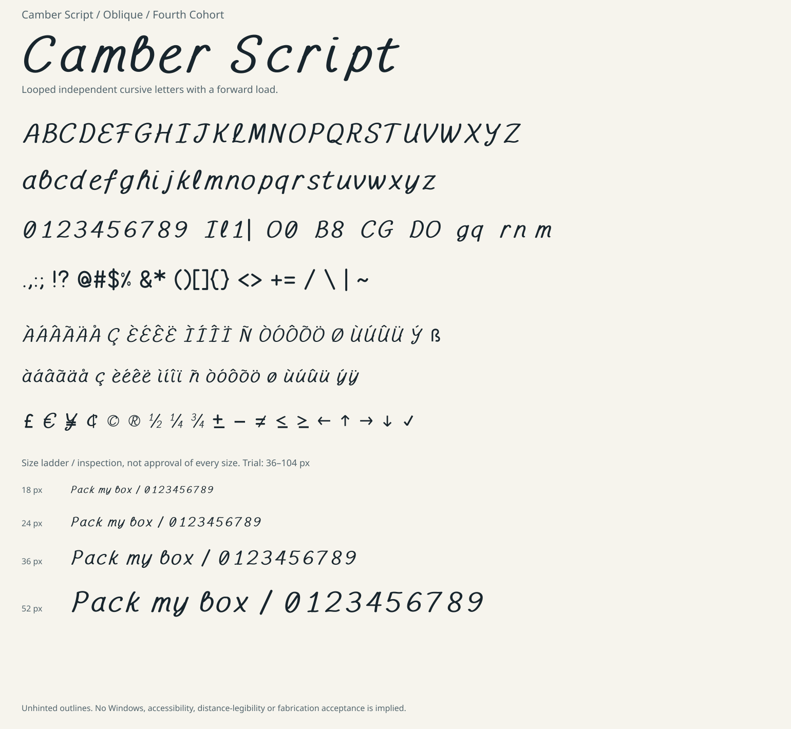

# Camber Script

**Oblique / version 1.000** — Looped independent cursive letters with a forward load.



## Payload and source

| File | Purpose |
|---|---|
| `fonts/CamberScript-Oblique.ttf` | Desktop TrueType outline font |
| `fonts/CamberScript-Oblique.woff2` | Compressed web font, same drawings and metrics |
| [source/design.py](source/design.py) | Editable family-specific recipe |
| [Shared new master](../../tools/fourth_cohort/masters/camber.py) | Newly authored alphabet/figures used by this lineage's two faces |
| [DESIGN.md](DESIGN.md) | Technique, artistic goal, intended utility and limitations |
| [specimen/index.html](specimen/index.html) | Interactive local tester; preserve adjacent fonts folder |
| [Character map](specimen/character-map.svg) | Exact 254-codepoint inventory |
| [OFL.txt](OFL.txt) | SIL Open Font License 1.1, no Reserved Font Names |

This is one new face, not a multi-weight family. Lowercase is present. The new
`camber` alphabet is shared openly with **Flux Stitch**; no earlier font's
letters or grids were used as its master. Neutral punctuation/auxiliary recipes
are shared as described in DESIGN.md.

## Use and preview

Install the TTF through the operating system's font installer. Native Windows
installation and rendering have not been accepted in this task. For a preview
without installation, open the local HTML tester from a checkout. GitHub's
source viewer does not execute the tester. It warns on missing characters or
font-load failure rather than silently presenting fallback as this font.

The initial trial range is **36–104 px**. This is a design
context, not a claim of measured legibility, comfort or accessibility. Read
DESIGN.md before using a display/experimental face for actual information.
No kerning, ligatures, hinting, bitmap strikes, combining-mark layout or general
non-Latin repertoire is supplied.

```css
@font-face {
  font-family: "Camber Script";
  src: url("fonts/CamberScript-Oblique.woff2") format("woff2");
  font-style: oblique;
  font-weight: 400;
}
```

## Rebuild

From the repository root:

```sh
python -m pip install -r requirements-fourth-cohort.txt
python tools/fourth_cohort/build.py
python tools/fourth_cohort/docs.py
python tools/fourth_cohort/specimen.py
python tools/fourth_cohort/verify.py --require-ots
python tools/fourth_cohort/docs.py --check
python tools/fourth_cohort/specimen.py --check
python tools/fourth_cohort/browser_smoke.py
```

OTS and Chromium installation, isolated builds, report refresh, source provenance
and release limits are in the [cohort workflow](../../docs/FOURTH-COHORT-WORKFLOW.md).
Commit intentional source and regenerated outputs together. The licence covers
this new font software, not unrelated older repository material.
