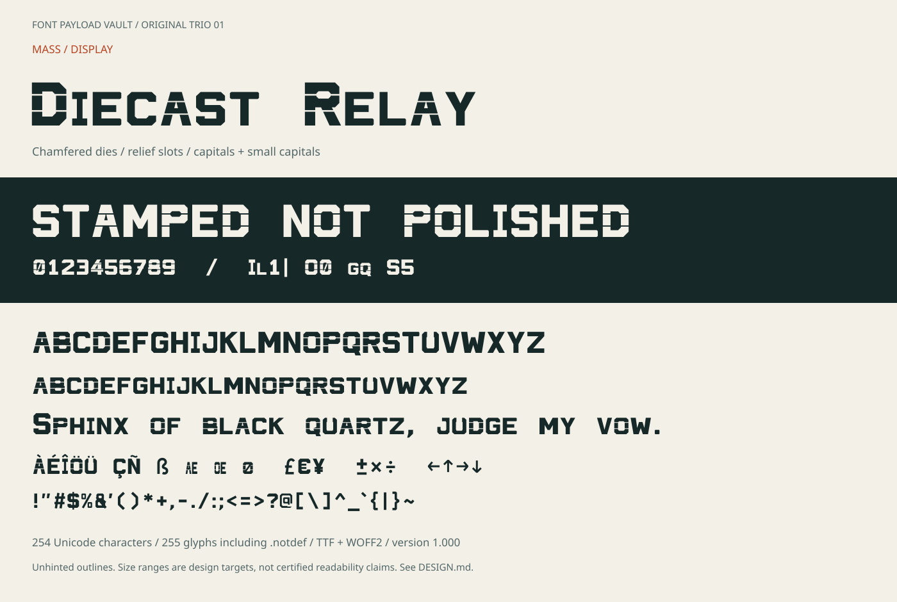

# Diecast Relay

An original heavy display face made from chamfered solids, counters and narrow
relief slots. Workshop labels, title cards and splash screens rather than prose.
Lowercase input produces **smaller capitals**, intentionally.



| Item | Value |
|---|---|
| Installable family | **Diecast Relay** |
| Style | Regular, version 1.000; a single visually heavy design |
| Desktop | [`fonts/DiecastRelay-Regular.ttf`](fonts/DiecastRelay-Regular.ttf) |
| Web | [`fonts/DiecastRelay-Regular.woff2`](fonts/DiecastRelay-Regular.woff2) |
| Spacing | Proportional, with tabular numerals and ten GPOS kerning pairs |
| Coverage | 254 Unicode characters; 255 glyphs including `.notdef` |
| Initial trial sizes | 32–96 px and larger, with the relief slots checked visually |
| Licence | [SIL OFL 1.1](OFL.txt), no Reserved Font Names |

Try [`specimen/index.html`](specimen/index.html) locally; GitHub's file viewer
cannot run the tester. See the [character map](specimen/character-map.svg) for
exact coverage. The tester supports size, spacing, kerning and polarity changes,
and warns when the font or a requested character is missing.

Install the TTF through your operating system's font installer and select
**Diecast Relay**. For web use, `font-weight: 400` selects this single Regular
face even though its artwork is heavy. Avoid synthesized bold: it can erase the
fine slots. The lowercase codepoints are drawn small capitals, not OpenType
substitutions, so a sentence is not rendered in conventional lowercase.

This is **not a proven production stencil**, safety-signage font or accessibility
aid. Slot motifs do not establish material strength, counter-island retention or
minimum manufacturable size. There are no embedded bitmap strikes, hinting,
italics or additional weights. Unicode coverage is limited to the declared Latin
repertoire and selected symbols; decomposed accents and other scripts fall back.

Read [DESIGN.md](DESIGN.md) for the polygon construction, small-cap policy,
spacing and practical limits. See the shared
[build workflow](../../docs/ORIGINAL-TRIO-WORKFLOW.md). From the repository root:

```sh
python -m pip install -r requirements-original-trio.txt
python tools/original_trio/build.py
python tools/original_trio/verify.py
python tools/original_trio/specimen.py
```

This folder and its original source, outputs and documentation are Font Software
under the included OFL. Knurled Swarf and existing repository material retain
their previous status.
